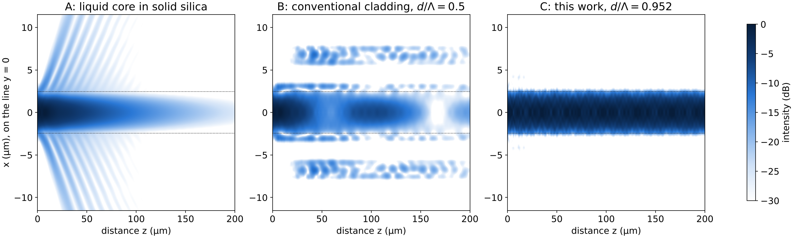

# Stochastic soliton dynamics in a serum-filled liquid-core PCF

Code, numerical results, figures and videos for the paper

> T. Rahman, S. Ryehan, M. I. Hossain, M. I. Z. Soma, M. T. Islam,
> "Stochastic soliton dynamics in a serum-filled liquid-core photonic crystal fiber for refractometric glucose
> sensing: Bifurcation analysis, exact solutions and numerical design" (submitted to *Optics & Laser Technology*).

The paper connects a stochastic nonlinear Schrödinger equation with multiplicative noise to pulse propagation in a
liquid-core photonic crystal fiber filled with blood serum, designs such a fiber for 1064 nm, and evaluates it as an
interferometric glucose refractometer. Every number and figure of the paper can be regenerated from this repository.



*The same beam launched into a liquid core in solid silica (A), a conventional photonic-crystal cladding (B) and the
fiber of this work (C). Only C keeps the light in the liquid. Videos: [`videos/`](videos).*

## Repository layout

| Folder | Content |
|---|---|
| [`matlab/`](matlab) | **MATLAB scripts (main).** `paper_figures.m` draws Figs. 5–12 as editable `.fig` files; `m1`–`m7` re-implement the analytical, stochastic, propagation, sensing and beam-propagation calculations, and `m7` writes the videos. See [`matlab/README_matlab.md`](matlab/README_matlab.md). |
| [`code/`](code) | Python scripts: symbolic verification, stochastic simulations, full-vector mode solver, fiber design, sensing analysis, data export and the published figures |
| [`out/`](out) | Numerical results (JSON, NPZ, and `figure_data.mat` for MATLAB) and the logs of the runs used in the paper |
| [`figs/`](figs) | The twelve figures of the paper (PNG at 600 dpi and vector PDF) |
| [`videos/`](videos) | Beam propagation in the three fibers as MP4 (1080 × 1080 per fiber, 1920 × 720 side by side) and the side view |
| [`comsol/`](comsol) | COMSOL model of the cross-section (LiveLink script, step-by-step guide, geometry files); not executed by the authors |
| [`data/`](data) | How to obtain the public glucose data set (the file itself is not redistributed) |

## Quick start in MATLAB

```matlab
cd matlab
paper_figures            % Figs. 5-12 as editable .fig + .png in matlab/figures_paper/ (seconds)
m1_phase_portraits       % Fig. 2: phase portraits and equilibria
m2_exact_solutions       % Fig. 4: exact solutions, checked against the ODE
m6_beam_propagation      % Fig. 9: beam propagation in fibers A, B, C (about 9 min)
m7_propagation_movie     % Fig. 10 and the four videos, written to matlab/videos_m7/ (6-10 min)
```

Base MATLAB R2016b or later is enough; GNU Octave also works (without the `.fig` files and the videos).

## Quick start in Python

Python 3.11 or later: `pip install -r requirements.txt`. Run the scripts from inside `code/`; they read and write
`../out` and `../figs`. To see a figure in a window as well, set the environment variable `SHOW=1`
(PowerShell: `$env:SHOW=1`).

| Step | Scripts | Paper |
|---|---|---|
| Mathematics | `verify_math.py`, `verify_families.py` (symbolic checks of the reduction and of all solutions) | Sections 2–4 |
| Stochastic simulations | `sim_pathwise.py`, `sim_final.py path`, `sim_final.py ens`, `sim_final.py ito` (minutes) | Section 5, Fig. 5, Table 4 |
| Mode-solver validation | `validate_he11.py`, `validate_six_hole.py` | Section 6.2 |
| Fiber design | `fibre_results.py design\|sweep\|sens\|conv\|modes\|rings\|fsm` (about 30 min) | Section 6, Figs. 6–8 |
| Data set | `kaggle_summary.py <csv>`, `fibre_results.py kaggle`, `kaggle_analysis.py`, `table8.py` | Section 7.3, Table 8, Fig. 12 |
| Derived quantities | `derive.py`, `sim_fibre.py` | Sections 6.4, 7 |
| Beam propagation | `matlab/m6_beam_propagation.m`, then `bpm_export.py ../matlab/bpm_results.mat`; `bpm_movie.py` (videos, side view; needs ffmpeg) | Section 6.5, Figs. 9, 10 |
| Figures | `fig_phase.py`, `fig_solutions.py`, `fig_stoch.py`, `fig_fibre.py`, `fig_bpm.py`, `fig_side.py`, `fig_sensing.py`, `fig_kaggle.py` | Figs. 1–12 |
| Export for MATLAB | `export_figure_data.py` → `out/figure_data.mat` | — |

`run_all.sh` runs the whole sequence. The figures of the paper (`figs/`) were drawn with the Python scripts; the MATLAB
script `paper_figures.m` draws the same data so that they can be edited.

## What is validated, and how

- The reduction to the ordinary differential equation and every closed-form solution are verified symbolically (SymPy).
- The stochastic integrator does not use the gauge transformation; it converges to the exact solution with order one
  along a fixed Brownian path, and the statistics of 4000 paths agree with the exact formulas.
- The mode solver is checked against the exact HE11 mode of a step-index rod, against the multipole benchmark of
  White et al. (J. Opt. Soc. Am. B 19, 2322, 2002) for a six-hole fiber including the confinement loss, and by grid refinement.
- The MATLAB/Octave scripts reproduce the deterministic Python results (`matlab/octave_output.txt`).
- The beam-propagation code reproduces the exact leaky-mode loss of a liquid core in silica to 0.3 %, and its scalar
  mode of the fiber agrees with an independent scalar eigenvalue solver to 1 × 10⁻⁵ (`out/validate_bpm_scalar.log`).

The fiber is a numerical design and has not been fabricated. No COMSOL results are used in the paper.

## Data

Section 7.3 uses the column `blood_glucose_level` of the "Diabetes prediction dataset" by M. Mustafa on Kaggle
(https://www.kaggle.com/datasets/iammustafatz/diabetes-prediction-dataset). Only the 18 distinct values and their
counts (`out/kaggle_levels.json`) are stored here; see [`data/README.md`](data/README.md).

## Licence and citation

MIT licence ([`LICENSE`](LICENSE)). If you use the code, please cite the paper ([`CITATION.cff`](CITATION.cff)).

Contact: Shahariar Ryehan (corresponding author; address in the paper).
